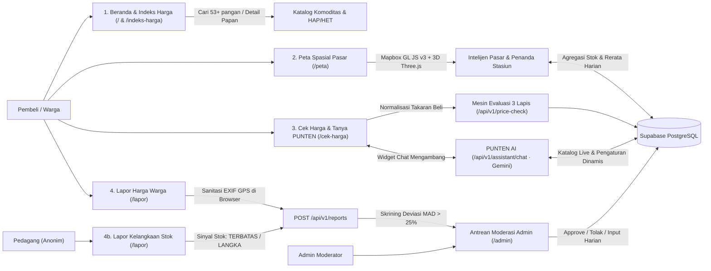

<div align="center">

<picture>
  <source media="(prefers-color-scheme: dark)" srcset="docs/images/banner-dark.png" />
  
</picture>

<br />

**Alat Bantu Keputusan Harga Pangan Rakyat & Intelijen Pasar Tradisional**

*"Tahu harga sebelum ke pasar, beli tenang tanpa menebak."*

<p>
  
  
  
  
  
  
</p>

[Sekilas](#sekilas-proyek) · [Galeri](#galeri) · [Fitur](#fitur-utama) · [System Flow](#system-flow) · [Lorong 3D](#lorong-pasar-3d) · [Mesin 3 Lapis](#mesin-evaluasi-3-lapis) · [Rute & API](#rute-halaman--api) · [Arsitektur](#arsitektur-teknis) · [Instalasi](#menjalankan-secara-lokal)

</div>

---

## Sekilas Proyek

**PasarKu** adalah platform web transparansi harga pangan pasar rakyat. Ia menjembatani data makro pemerintah dengan kebutuhan transaksi harian pembeli dan pedagang di pasar tradisional.

Dibuat untuk kompetisi **Web In Action (MIA 2026)**. Pilot di **Kota Bogor** (13 pasar Perumda Pasar Pakuan Jaya), dirancang berkembang ke Jabodetabek, Jawa Barat, hingga nasional lintas 6 koridor pulau.

<!-- Thumbnail video demo: ganti GANTI_LINK_DEMO dengan link YouTube/Drive -->
<p align="center">
  <a href="GANTI_LINK_DEMO">
    
  </a>
</p>

| Masalah di lapangan | Jawaban PasarKu |
| :-- | :-- |
| Data resmi (PIHPS, Bapanas) per kg, belanja warga per ons atau ikat | Kalkulator takaran mengubah satuan ke Rupiah riil dan rentang tawar |
| Pembeli tak tahu tawaran pedagang wajar atau tidak | Mesin 3 lapis menilai kewajaran harga sebelum transaksi |
| Kelangkaan stok terlambat diketahui warga | Sinyal stok anonim langsung dari pedagang |
| Warga takut lokasi rumah terlacak lewat foto laporan | EXIF dan GPS dibersihkan di browser sebelum upload |

---

## Galeri

<table>
  <tr>
    <td align="center" width="50%">
      
      <br /><sub><b>Beranda</b> · hero dan papan acuan cepat</sub>
    </td>
    <td align="center" width="50%">
      
      <br /><sub><b>Lorong Pasar 3D</b> · POV dua tangan</sub>
    </td>
  </tr>
  <tr>
    <td align="center" width="50%">
      
      <br /><sub><b>Cek Harga</b> · kalkulator takaran + PUNTEN AI</sub>
    </td>
    <td align="center" width="50%">
      
      <br /><sub><b>Peta Spasial</b> · 13 pasar Bogor</sub>
    </td>
  </tr>
  <tr>
    <td align="center" width="50%">
      
      <br /><sub><b>Lapor</b> · jalur warga dan pedagang</sub>
    </td>
    <td align="center" width="50%">
      
      <br /><sub><b>Admin</b> · moderasi dan konfigurasi</sub>
    </td>
  </tr>
</table>

---

## Fitur Utama

| # | Fitur | Cara kerja singkat | Manfaat |
| :-: | :-- | :-- | :-- |
| 1 | **Lorong Pasar 3D** | Simulasi Three.js menyusuri 20 lapak, lengkap tata suara prosedural | Belanja pasar yang interaktif dan edukatif |
| 2 | **Indeks 53+ Komoditas** | Katalog dengan 5 kategori, pencarian, dan pembanding HAP/HET | Tahu acuan resmi sebelum berangkat |
| 3 | **Cek Harga + PUNTEN AI** | Takaran dan harga tawaran dinilai, chatbot Gemini siap bantu menawar | Keputusan di depan lapak dalam hitungan detik |
| 4 | **Peta Spasial 3D** | Mapbox GL JS v3 dengan 13 pasar, peringkat harga, dan sinyal kelangkaan | Menemukan pasar terdekat yang harganya wajar |
| 5 | **Lapor Dua Arah Anonim** | Warga lapor harga, pedagang lapor stok, anomali dicek dengan MAD > 25% | Data komunitas akurat dan privasi terjaga |
| 6 | **Konsol Admin** | Moderasi laporan, entri survei harian, CRUD master, konfigurasi dinamis | Data publik terjaga tanpa redeploy |

**Detail tambahan yang sering ditanyakan:**

| Fitur | Rincian |
| :-- | :-- |
| Kategori indeks | Beras, Cabai & Bawang, Daging & Telur, Minyak & Gula, Sayur & Buah |
| Status kewajaran | Wajar, Agak Mahal, Terlalu Mahal, Jauh Lebih Murah |
| Mode Ringan peta | Tabel alternatif untuk kuota dan perangkat hemat daya |
| Jalur Warga (`PRICE`) | Harga riil plus foto nota, EXIF dan GPS dibersihkan di browser |
| Jalur Pedagang (`SHORTAGE`) | Status stok Terbatas, Langka, atau Pulih, tanpa nama kios |
| Pengaturan dinamis | API key Gemini, model AI, instruksi sistem, dan token Mapbox dari database |

---

## System Flow

Alur interaksi pengguna, pemrosesan data, integrasi AI, dan moderasi di Supabase PostgreSQL:



---

## Lorong Pasar 3D

Pengalaman visual pasar tradisional lengkap dengan kain atap, papan komoditas gantung, dan gerbang kayu. Tangan kiri memegang keranjang bambu berkapasitas 7 barang. Tangan kanan meraih barang dengan animasi 3 fase (*reach*, *carry*, *drop*) sebelum modal harga terbuka. Papan komoditas dibuat dua sisi sehingga tetap terbaca dari arah belakang.

Suara disintesis penuh dengan Web Audio API (deru pasar, langkah kaki, petikan, dentum keranjang) plus loop gamelan Pelog/Slendro, tanpa satu pun file audio.

| Aksi | Kontrol |
| :-- | :-- |
| Ambil barang | Klik lapak pedagang |
| Keluarkan barang | Klik item di keranjang bambu |
| Jalan maju / mundur | `↑` / `↓` atau scroll mouse/touchpad |
| Pandang kiri / kanan | `←` `→` atau `Q` `E` |
| Pandang bebas 360° | Seret kanvas (mouse atau touch) |
| Reset pandangan | `R` atau tombol **Hadap Depan** |
| Suara | Toggle HUD **Bisu** ↔ **Suara Aktif** |

---

## Mesin Evaluasi 3 Lapis

Fungsi `evaluatePrice` membandingkan harga tawaran dengan tiga acuan, berurutan dari prioritas tertinggi.

| Lapis | Acuan | Sumber data |
| :-: | :-- | :-- |
| 1 | HAP/HET nasional terkalibrasi | Bapanas RI × indeks logistik wilayah (`1.00x` Jawa sampai `1.28x` Maluku-Papua) |
| 2 | Survei pasar resmi | Rata-rata tabel `daily_prices` (PIHPS BI, Perumda PPJ) |
| 3 | Laporan warga terverifikasi | Median laporan `APPROVED` (min. 2), fallback median kota/wilayah |

| Selisih vs acuan | Status | Saran |
| :-: | :-- | :-- |
| < -15% | Jauh Lebih Murah | Cek mutu dan timbangan |
| -10% s.d. +10% | Wajar | Sesuai kisaran transaksi daerah |
| +10% s.d. +25% | Agak Mahal | Sebaiknya menawar |
| > +25% | Terlalu Mahal | Melebihi batas toleransi |

**Rollout 4 fase** (dipilih lewat Top Navbar, berlaku di seluruh halaman):

| Fase | Cakupan | Fokus |
| :-: | :-- | :-- |
| F1 | Kota Bogor | Pilot 13 pasar Perumda PPJ |
| F2 | Jabodetabek | Aglomerasi DKI, Bogor, Depok, Tangerang, Bekasi |
| F3 | Jawa Barat | Sentra hortikultura dan pasar rakyat |
| F4 | Nasional | 23 wilayah, 6 koridor pulau, 74 pasar |

---

## Rute Halaman & API

| Rute | Modul | Fungsi utama |
| :-- | :-- | :-- |
| `/` | Beranda | Hero, Lorong 3D, papan 10 komoditas, peta 3D, widget PUNTEN AI |
| `/indeks-harga` | Indeks Harga | Katalog 53+ pangan, pencarian, filter, pembanding HAP/HET |
| `/cek-harga` | Cek Harga | Kalkulator takaran, selisih 3 lapis, rentang tawar, chat AI |
| `/peta` | Peta Spasial | Mapbox penuh, filter komoditas, peringkat pasar, Mode Ringan |
| `/lapor` | Lapor Lapangan | Laporan harga warga dan status stok pedagang |
| `/dashboard` | Dashboard Tren | Sparkline 14 hari dan komparasi antar wilayah |
| `/tentang` | Metodologi | Penjelasan 3 lapis, sumber data, disclaimer simulasi |
| `/admin` | Konsol Admin | Moderasi, entri harga, CRUD master, konfigurasi |

<details>
<summary><b>Daftar endpoint REST API (<code>/api/v1/*</code>)</b></summary>

<br />

| Method | Endpoint | Fungsi |
| :-- | :-- | :-- |
| `GET` | `/api/v1/regions` | Wilayah 6 koridor pulau, filter phase, island, nama |
| `GET` | `/api/v1/commodities` | Master komoditas dan agregasi harga harian |
| `GET` | `/api/v1/commodities/[slug]` | Detail komoditas, riwayat, dan batas HAP/HET |
| `GET` | `/api/v1/markets` | Pasar per wilayah dengan koordinat dan flag stasiun |
| `GET` | `/api/v1/markets/insights` | Komoditas mahal (deviasi > 10%) dan sinyal kelangkaan |
| `POST` | `/api/v1/price-check` | Normalisasi takaran dan evaluasi 3 lapis |
| `GET` `POST` | `/api/v1/reports` | Ambil laporan terverifikasi atau kirim laporan baru (MAD) |
| `POST` | `/api/v1/assistant/chat` | Percakapan PUNTEN AI (Gemini) dengan konteks harga terkini |
| `GET` | `/api/v1/map/config` | Token publik Mapbox dari database |
| `GET` `POST` `PUT` | `/api/v1/admin/*` | Autentikasi, sinkronisasi, entri harga, pengaturan |

</details>

---

## Arsitektur Teknis

| Lapisan | Teknologi |
| :-- | :-- |
| Frontend | Next.js 16 (App Router), React 19.3, TypeScript 5.7 strict, Tailwind v4 |
| Desain | Font Ubuntu, dual-theme (Siang & Subuh), Phosphor Icons, ornamen Sunda/Bogor |
| 3D & Spasial | Three.js (Lorong, maskot PUNTEN, layer bangunan) + Mapbox GL JS v3 |
| Backend | Route Handlers `/api/v1/*`, PostgreSQL Supabase via `pg`, SQL berparameter tanpa ORM |
| Fallback | Data terkurasi otomatis saat koneksi database offline |
| AI | Google Gemini, kunci disimpan server-only di tabel `system_settings` |
| Privasi | Sanitasi EXIF/GPS di klien, sinyal stok diagregasi per pasar tanpa nama kios |

<details>
<summary><b>Struktur folder & skema 6 tabel PostgreSQL</b></summary>

<br />

```text
PasarKu/
├── src/
│   ├── app/          # Rute App Router + API /api/v1/*
│   ├── components/   # landing/pasarku, indeks, price, peta, lapor, assistant, admin, ornament
│   ├── lib/          # Logika 3 lapis, fetcher, koneksi pg, store, seed data & wilayah
│   └── types/        # Kontrak tipe TypeScript (zero any)
├── supabase/schema.sql   # DDL + Row Level Security
├── scripts/              # Seeder UNNEST & suite uji otomatis
├── docs/images/          # Banner, thumbnail, screenshot README
├── public/               # Aset gambar, ikon, ornamen
├── .env.example
└── README.md
```

| Tabel | Peran |
| :-- | :-- |
| `regions` | 23 wilayah, metadata `phase`, `logistics_cost_pct`, `disparity_index` |
| `commodities` | Master pangan, kategori, satuan, ambang wajar, `hap_het_price` |
| `markets` | Pasar binaan PPJ & nasional, koordinat, jam buka, `near_station` |
| `daily_prices` | Survei harian per `(market_id, commodity_id)` untuk Lapis 2 |
| `citizen_reports` | Laporan `PRICE` / `SHORTAGE`, deviasi MAD, status, `exif_sanitized` |
| `system_settings` | Konfigurasi server-only: kunci Gemini, model, instruksi PUNTEN, token Mapbox |

</details>

---

## Menjalankan Secara Lokal

**Prasyarat:** Node.js ≥ 20 (disarankan 22+ untuk `--experimental-strip-types`) dan PostgreSQL/Supabase, atau mode fallback dengan `NEXT_PUBLIC_USE_MOCK="true"`.

```bash
cd PasarKu
npm install
cp .env.example .env.local
```

Isi `.env.local` sesuai template `.env.example`:

| Variabel | Kegunaan |
| :-- | :-- |
| `DATABASE_URL`, `NEXT_PUBLIC_SUPABASE_URL`, `NEXT_PUBLIC_SUPABASE_ANON_KEY` | Koneksi Supabase PostgreSQL |
| `ADMIN_SESSION_SECRET` | String acak ≥ 32 karakter untuk sesi `/admin` |
| `NEXT_PUBLIC_APP_URL`, `NEXT_PUBLIC_API_URL`, `NEXT_PUBLIC_USE_MOCK` | URL aplikasi dan fallback data offline |
| `GEMINI_API_KEY`, `NEXT_PUBLIC_MAPBOX_TOKEN` | Opsional, cadangan jika belum diisi dari panel admin |

```bash
# Inisialisasi schema dan seed data
node --experimental-strip-types scripts/init-supabase-db.mjs

# Jalankan server lokal di http://localhost:3000
npm run dev
```

```bash
npm run typecheck   # tipe ketat, zero error
npm test            # kalkulasi 3 lapis, store admin, auth, interaksi lorong 3D
npm run build       # build produksi Next.js (--webpack)
```

---

> **Catatan Integritas Data & Privasi:** Seluruh data simulasi untuk demonstrasi diberi penanda visual yang transparan. PasarKu mencantumkan rujukan sumber resmi (Bapanas RI & PIHPS Bank Indonesia), membersihkan metadata EXIF GPS di sisi browser, dan mengagregasi sinyal stok di level pasar tanpa mengekspos identitas kios perseorangan.