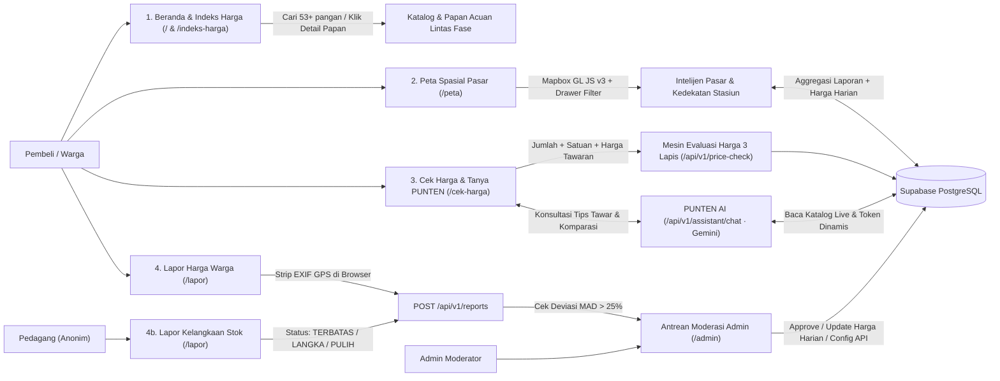

<div align="center">

  <h1>PasarKu</h1>
  <p><strong>Alat Bantu Keputusan Harga Pangan Rakyat</strong></p>
  <p><em>"Tahu harga sebelum ke pasar, beli tenang tanpa menebak."</em></p>

  <p>
    
    
    
    
    
  </p>

  <p>
    <a href="#sekilas">Sekilas</a> &middot;
    <a href="#system-flow">System Flow (Juri)</a> &middot;
    <a href="#mesin-3-lapis">Mesin 3 Lapis</a> &middot;
    <a href="#rute-halaman">Peta Rute &amp; API</a> &middot;
    <a href="#arsitektur-teknis">Arsitektur &amp; DB</a> &middot;
    <a href="#jalankan-lokal">Instalasi Lokal</a>
  </p>

</div>

<hr />

<h2 id="sekilas">Sekilas Proyek &amp; Posisi PasarKu</h2>

<p>
  <strong>PasarKu</strong> adalah platform web interaktif berbasis transparansi harga pangan pasar rakyat yang membantu pembeli rumah tangga dan pelaku usaha kecil menjawab satu pertanyaan praktis di depan lapak:
  <strong>"Untuk jumlah yang saya beli ini, harga tawaran pedagang wajar atau kemahalan?"</strong>
</p>

<table>
  <thead>
    <tr>
      <th width="50%" align="left">Situasi di Lapangan</th>
      <th width="50%" align="left">Pendekatan &amp; Posisi PasarKu</th>
    </tr>
  </thead>
  <tbody>
    <tr>
      <td valign="top">
        <ul>
          <li>Data resmi pemerintah (<strong>PIHPS Bank Indonesia</strong> &amp; <strong>Panel Harga Bapanas RI</strong>) tersaji dalam tabel agregat makro yang kurang praktis bagi pembeli eceran.</li>
          <li>Pembeli sering berbelanja dalam takaran harian (<code>1/4 kg</code>, <code>1/2 kg</code>, <code>1 ons</code>, <code>1 ikat</code>), sehingga sulit menghitung deviasi harga <code>/kg</code> secara cepat.</li>
          <li>Dinamika harga lokal dan kelangkaan stok di pasar spesifik (seperti koridor pasar dekat Stasiun Bogor) belum tersampaikan secara langsung ke pembeli.</li>
        </ul>
      </td>
      <td valign="top">
        <ul>
          <li><strong>Melengkapi, bukan menggantikan PIHPS:</strong> PasarKu menjadi lapisan keputusan belanja (<em>decision layer</em>) yang menerjemahkan data resmi ke skenario transaksi nyata.</li>
          <li><strong>Kalkulasi Berbasis Takaran Nyata:</strong> Masukkan komoditas, takaran beli, dan nominal tawaran untuk melihat selisih Rupiah langsung beserta saran tawar.</li>
          <li><strong>Crowdsourcing Dua Arah Anonim:</strong> Menggabungkan acuan resmi (Bapanas, PIHPS, Perumda PPJ Kota Bogor), laporan harga warga, dan sinyal kelangkaan stok pedagang tanpa menyebut nama kios individu.</li>
        </ul>
      </td>
    </tr>
  </tbody>
</table>

<hr />

<h2 id="system-flow">System Flow End-to-End (Untuk Penilaian Juri)</h2>

<p>
  Diagram dan tabel alur berikut merangkum perjalanan pengguna dari eksplorasi awal di Beranda hingga keputusan harga di lapak, pelaporan lapangan, dan moderasi data di Supabase PostgreSQL.
</p>



<table>
  <thead>
    <tr>
      <th width="8%" align="center">Tahap</th>
      <th width="22%" align="left">Modul &amp; Rute</th>
      <th width="42%" align="left">Alur Interaksi Pengguna &amp; Pemrosesan Sistem</th>
      <th width="28%" align="left">Output / Nilai Bagi Pengguna</th>
    </tr>
  </thead>
  <tbody>
    <tr>
      <td align="center"><strong>1</strong></td>
      <td><strong>Lorong 3D &amp; Indeks Harga</strong><br /><code>/</code> dan <code>/indeks-harga</code></td>
      <td>
        Pengguna masuk melalui <strong>Lorong Pasar 3D WebGL</strong> (Three.js, 20 lapak interaktif + POV keranjang) atau meninjau <strong>Papan Acuan 10 Komoditas</strong> di Beranda. Menekan tombol <code>Detail Papan</code> atau ikon <code>Cari</code> membuka halaman <code>/indeks-harga</code> untuk mencari seluruh <strong>53+ komoditas pangan</strong>, menyaring kategori, serta mengganti fase wilayah di Navbar.
      </td>
      <td>Acuan harga cepat sebelum berangkat belanja lintas wilayah dan perbandingan langsung dengan HAP/HET Nasional.</td>
    </tr>
    <tr>
      <td align="center"><strong>2</strong></td>
      <td><strong>Peta Pasar Spasial</strong><br /><code>/#unitPasarSection</code> &amp; <code>/peta</code></td>
      <td>
        Beranda menyajikan <strong>Peta 3D 13 Unit Pasar Kota Bogor</strong> (Mapbox + Three.js Custom Layer). Halaman <code>/peta</code> memperluas kanvas Mapbox GL JS v3 secara penuh dengan <strong>Menu Drawer Hamburger</strong> berisi filter komoditas, legenda relatif, peringkat pasar termurah ke termahal, serta opsi <em>Mode Ringan</em> (tabel).
      </td>
      <td>Menemukan pasar paling wajar terdekat (termasuk penanda koridor <em>Dekat Stasiun Bogor</em>) dan sinyal stok/harga mahal.</td>
    </tr>
    <tr>
      <td align="center"><strong>3</strong></td>
      <td><strong>Cek Harga &amp; PUNTEN AI</strong><br /><code>/cek-harga</code></td>
      <td>
        Alur <strong>Kartu Kasir Sederhana</strong>: pilih contoh cepat atau masukkan barang, pasar, takaran populer (<code>1 kg</code>, <code>1/2 kg</code>, <code>1/4 kg</code>, <code>1 ons</code>), dan harga tawaran penjual. Endpoint <code>/api/v1/price-check</code> menormalkan ke harga per kg lalu mengevaluasi terhadap 3 lapis acuan. Pengguna juga dapat langsung bertanya ke <strong>PUNTEN AI</strong> (dipandu Maskot 3D reaktif) atau mengeklik ajakan <em>"Lagi cari harga apa nih?"</em> saat scroll.
      </td>
      <td>Putusan instan dalam nominal Rupiah nyata untuk takaran yang dibeli, kisaran harga tawar aman, rincian 4 sumber resmi, dan tips tawar dari PUNTEN.</td>
    </tr>
    <tr>
      <td align="center"><strong>4</strong></td>
      <td><strong>Lapor Dua Arah Anonim</strong><br /><code>/lapor</code></td>
      <td>
        <strong>Jalur Warga (PRICE):</strong> Melaporkan harga riil di lapak beserta foto bukti. Metadata <strong>EXIF / koordinat GPS disanitasi otomatis di browser</strong> sebelum diunggah.<br />
        <strong>Jalur Pedagang (SHORTAGE):</strong> Melaporkan status pasokan (<code>TERBATAS</code>, <code>LANGKA</code>, <code>PULIH</code>) secara anonim tanpa mencatat nama kios individu.
      </td>
      <td>Memperbarui lapis harga warga secara partisipatif dan memberi peringatan dini kelangkaan pasokan per unit pasar.</td>
    </tr>
    <tr>
      <td align="center"><strong>5</strong></td>
      <td><strong>Validasi &amp; Konsol Admin</strong><br /><code>/admin</code></td>
      <td>
        Laporan dengan selisih <code>&gt; 25%</code> dari rerata pasar otomatis ditandai <code>ANOMALY</code>. Moderator memverifikasi laporan di <code>/admin</code> (<code>APPROVED</code> / <code>REJECTED</code>), memperbarui matriks harga harian (<code>daily_prices</code>), dan mengelola API Key Gemini serta Token Mapbox dari tabel <code>system_settings</code> tanpa redeploy.
      </td>
      <td>Menjaga kredibilitas data lapangan bebas spam dan memastikan konfigurasi AI serta peta dinamis aman tersimpan di server.</td>
    </tr>
  </tbody>
</table>

<hr />

<h2 id="mesin-3-lapis">Mesin Evaluasi 3 Lapis &amp; Cakupan Rollout 4 Fase</h2>

<table>
  <thead>
    <tr>
      <th width="52%" align="left">Arsitektur 3 Lapis Harga (<code>evaluatePrice</code>)</th>
      <th width="48%" align="left">Strategi Ekspansi Wilayah 4 Fase</th>
    </tr>
  </thead>
  <tbody>
    <tr>
      <td valign="top">
        <p><strong>Prioritas Pembanding Harga:</strong></p>
        <ol>
          <li><strong>Lapis 1 (Acuan Nasional Terkalibrasi):</strong> Batas HAP/HET Bapanas RI disesuaikan indeks logistik wilayah (<code>1.00x</code> Pulau Jawa s.d. <code>1.28x</code> Maluku-Papua).</li>
          <li><strong>Lapis 2 (Survei Pasar Resmi):</strong> Rata-rata survei harian pasar daerah (PIHPS Bank Indonesia &amp; Perumda Pasar Pakuan Jaya) pada <code>daily_prices</code>.</li>
          <li><strong>Lapis 3 (Laporan Warga Terverifikasi):</strong> Median laporan <code>APPROVED</code> di pasar terpilih (minimal 2 laporan) atau fallback median kota/wilayah.</li>
        </ol>
        <p><strong>Klasifikasi Status Tawaran:</strong></p>
        <ul>
          <li><code>&lt; -15%</code> : <strong>Jauh Lebih Murah</strong> (cek mutu &amp; timbangan)</li>
          <li><code>-10% s.d. +10%</code> : <strong>Wajar</strong> (sesuai acuan transaksi daerah)</li>
          <li><code>+10% s.d. +25%</code> : <strong>Agak Mahal</strong> (disarankan menawar)</li>
          <li><code>&gt; +25%</code> : <strong>Terlalu Mahal</strong> (melebihi toleransi wajar)</li>
        </ul>
      </td>
      <td valign="top">
        <p>Pemilih fase terpusat di <strong>Top Navbar</strong> mengatur konteks wilayah di seluruh halaman:</p>
        <table>
          <thead>
            <tr>
              <th align="left">Fase</th>
              <th align="left">Cakupan Aktif</th>
              <th align="left">Fokus Data</th>
            </tr>
          </thead>
          <tbody>
            <tr>
              <td><code>F1</code></td>
              <td><strong>Kota Bogor</strong></td>
              <td>Pilot aktif <strong>13 unit pasar</strong> Perumda PPJ (termasuk Kebon Kembang/Anyar, Devries, Merdeka dekat Stasiun Bogor).</td>
            </tr>
            <tr>
              <td><code>F2</code></td>
              <td><strong>Jabodetabek</strong></td>
              <td>Aglomerasi konsumen DKI Jakarta, Bodebek, dan Banten.</td>
            </tr>
            <tr>
              <td><code>F3</code></td>
              <td><strong>Jawa Barat</strong></td>
              <td>Sentra produksi hortikultura dan pasar rakyat Jawa Barat.</td>
            </tr>
            <tr>
              <td><code>F4</code></td>
              <td><strong>Nasional</strong></td>
              <td><strong>23 cakupan wilayah</strong> lintas <strong>6 koridor pulau</strong> dan <strong>74 pasar</strong> dengan indeks disparitas logistik.</td>
            </tr>
          </tbody>
        </table>
      </td>
    </tr>
  </tbody>
</table>

<hr />

<h2 id="rute-halaman">Peta Rute Halaman &amp; Kontrak API</h2>

<table>
  <thead>
    <tr>
      <th width="18%" align="left">Rute</th>
      <th width="26%" align="left">Nama Halaman</th>
      <th width="56%" align="left">Fungsi Utama</th>
    </tr>
  </thead>
  <tbody>
    <tr>
      <td><code>/</code></td>
      <td><strong>Beranda PasarKu</strong></td>
      <td>Lorong Pasar 3D interaktif, Papan Acuan 10 Komoditas + tombol <code>Detail Papan</code>, Tanya Jawab singkat (3 pertanyaan), serta Peta 3D 13 Unit Pasar.</td>
    </tr>
    <tr>
      <td><code>/indeks-harga</code></td>
      <td><strong>Indeks Harga Lengkap</strong></td>
      <td>Detail penuh seluruh 53+ bahan pangan, bilah pencarian instan, chip kata kunci cepat, filter kategori, sort harga, modal rincian, &amp; mode tabel/kartu.</td>
    </tr>
    <tr>
      <td><code>/cek-harga</code></td>
      <td><strong>Cek Harga &amp; PUNTEN AI</strong></td>
      <td>Kalkulator Kartu Kasir Sederhana (konversi takaran harian ke selisih Rupiah) terintegrasi langsung dengan chat PUNTEN AI &amp; Maskot 3D. (Rute <code>/rekomendasi-ai</code> &amp; <code>/keranjang</code> otomatis diarahkan ke sini).</td>
    </tr>
    <tr>
      <td><code>/peta</code></td>
      <td><strong>Peta Harga Spasial</strong></td>
      <td>Kanvas penuh Mapbox GL JS v3, menu drawer hamburger (filter komoditas, peringkat pasar, kedekatan stasiun), &amp; Mode Ringan tabel.</td>
    </tr>
    <tr>
      <td><code>/lapor</code></td>
      <td><strong>Lapor Lapangan</strong></td>
      <td>Formulir dua sisi anonim: laporan harga warga (<code>PRICE</code> + sanitasi EXIF) dan sinyal kelangkaan stok pedagang (<code>SHORTAGE</code>).</td>
    </tr>
    <tr>
      <td><code>/dashboard</code></td>
      <td><strong>Dashboard Tren</strong></td>
      <td>Kartu sparkline 14 hari dan grafik fluktuasi pergerakan komoditas strategis lintas wilayah.</td>
    </tr>
    <tr>
      <td><code>/tentang</code></td>
      <td><strong>Tentang &amp; Metodologi</strong></td>
      <td>Penjelasan metodologi 3 lapis, transparansi sumber data resmi (PIHPS, Bapanas, Perumda PPJ), &amp; batas data simulasi.</td>
    </tr>
    <tr>
      <td><code>/admin</code></td>
      <td><strong>Konsol Moderasi Admin</strong></td>
      <td>Moderasi laporan warga/pedagang, CRUD komoditas &amp; pasar, entri cepat harga harian, dan pengaturan kunci Gemini + token Mapbox dinamis.</td>
    </tr>
  </tbody>
</table>

<details>
  <summary><strong>Lihat Daftar Endpoint REST API (<code>/api/v1/*</code>)</strong></summary>
  <br />
  <table>
    <thead>
      <tr>
        <th width="12%" align="left">Method</th>
        <th width="34%" align="left">Endpoint</th>
        <th width="54%" align="left">Deskripsi</th>
      </tr>
    </thead>
    <tbody>
      <tr><td><code>GET</code></td><td><code>/api/v1/regions</code></td><td>Daftar wilayah/provinsi 6 koridor pulau dengan filter <code>phase</code>, <code>island</code>, dan <code>search</code>.</td></tr>
      <tr><td><code>GET</code></td><td><code>/api/v1/commodities</code></td><td>Katalog komoditas aktif dan agregasi harga harian per wilayah dari Supabase.</td></tr>
      <tr><td><code>GET</code></td><td><code>/api/v1/commodities/[slug]</code></td><td>Rincian komoditas beserta riwayat tren dan perbandingan HAP/HET.</td></tr>
      <tr><td><code>GET</code></td><td><code>/api/v1/markets</code></td><td>Daftar pasar tradisional aktif per wilayah beserta koordinat dan penanda stasiun.</td></tr>
      <tr><td><code>GET</code></td><td><code>/api/v1/markets/insights</code></td><td>Agregasi item mahal (<code>diffPercent &gt; 10%</code>) dan sinyal kelangkaan stok per unit pasar.</td></tr>
      <tr><td><code>POST</code></td><td><code>/api/v1/price-check</code></td><td>Normalisasi takaran &amp; evaluasi penawaran terhadap Lapis 1, 2, dan 3 beserta konteks pasar.</td></tr>
      <tr><td><code>GET / POST</code></td><td><code>/api/v1/reports</code></td><td>Ambil laporan <code>APPROVED</code> teranonimkan atau kirim laporan baru dengan deteksi anomali MAD.</td></tr>
      <tr><td><code>POST</code></td><td><code>/api/v1/assistant/chat</code></td><td>Obrolan PUNTEN AI (Google Gemini) dengan konteks harga live multi-sumber berformat Markdown.</td></tr>
      <tr><td><code>GET</code></td><td><code>/api/v1/map/config</code></td><td>Menyajikan token publik Mapbox GL JS secara dinamis dari tabel <code>system_settings</code>.</td></tr>
      <tr><td><code>GET / POST / PUT</code></td><td><code>/api/v1/admin/*</code></td><td>Bootstrap admin, mutasi sinkronisasi (<code>/sync</code>), autentikasi (<code>/auth/login</code>), &amp; konfigurasi <code>/settings</code>.</td></tr>
    </tbody>
  </table>
</details>

<hr />

<h2 id="arsitektur-teknis">Arsitektur Teknis, Skema Database &amp; Struktur Proyek</h2>

<table>
  <thead>
    <tr>
      <th width="25%" align="left">Lapisan</th>
      <th width="75%" align="left">Teknologi &amp; Implementasi</th>
    </tr>
  </thead>
  <tbody>
    <tr>
      <td><strong>Frontend &amp; Desain</strong></td>
      <td>Next.js 16 (App Router), React 19.3, TypeScript Strict Mode, Tailwind CSS v4, tipografi tunggal Google Fonts Ubuntu, Dual-Theme (Mode Siang &amp; Mode Subuh), Phosphor Icons.</td>
    </tr>
    <tr>
      <td><strong>Grafis 3D &amp; Spasial</strong></td>
      <td>Three.js WebGL (Lorong Pasar 3D, Maskot 3D PUNTEN, &amp; Custom Layer bangunan pasar 3D) terintegrasi bersama Mapbox GL JS v3.</td>
    </tr>
    <tr>
      <td><strong>Backend &amp; Database</strong></td>
      <td>Next.js Route Handlers (<code>/api/v1/*</code>) terhubung ke PostgreSQL Supabase via Session Pooler <code>pg</code> dengan kueri SQL berparameter (tanpa ORM eksternal) dan fallback data terkurasi saat offline.</td>
    </tr>
    <tr>
      <td><strong>AI &amp; Privasi</strong></td>
      <td>Google Gemini API (kunci API dikelola dinamis server-only di tabel <code>system_settings</code>), sanitasi metadata EXIF di sisi klien sebelum kirim foto laporan, serta agregasi per pasar tanpa nama kios individu.</td>
    </tr>
  </tbody>
</table>

<details>
  <summary><strong>Lihat Struktur Folder &amp; Skema 6 Tabel PostgreSQL (<code>supabase/schema.sql</code>)</strong></summary>
  <br />
  <pre><code>PasarKu/
├── src/
│   ├── app/                  # Halaman App Router (/, /indeks-harga, /cek-harga, /peta, /lapor, /dashboard, /tentang, /admin) + API /api/v1/*
│   ├── components/           # Modul UI: landing/pasarku (3D Lorong &amp; Unit Pasar), indeks, price, peta, lapor, assistant, admin, ornament
│   ├── lib/                  # Kalkulasi harga 3 lapis, fetcher API, koneksi pg DB, store context, seed &amp; data wilayah
│   └── types/                # Kontrak TypeScript eksplisit (zero any)
├── supabase/schema.sql       # DDL PostgreSQL + Row Level Security (regions, commodities, markets, daily_prices, citizen_reports, system_settings)
├── scripts/                  # Seeder Supabase UNNEST (init-supabase-db.mjs) dan suite uji otomatis (verify-*.mjs)
├── public/                   # Aset gambar &amp; ornamen lokal PasarKu
├── .env.example              # Template konfigurasi environment variables
└── README.md                 # Dokumentasi proyek &amp; alur sistem</code></pre>
  <table>
    <thead>
      <tr>
        <th width="25%" align="left">Tabel PostgreSQL</th>
        <th width="75%" align="left">Peran Data</th>
      </tr>
    </thead>
    <tbody>
      <tr><td><code>regions</code></td><td>23 wilayah &amp; 6 koridor pulau lengkap dengan <code>phase</code> (1-4), <code>logistics_cost_pct</code>, dan <code>disparity_index</code>.</td></tr>
      <tr><td><code>commodities</code></td><td>Master komoditas, kategori, satuan standar, toleransi kewajaran, serta acuan <code>hap_het_price</code>.</td></tr>
      <tr><td><code>markets</code></td><td>Unit pasar rakyat termasuk 13 pasar Perumda PPJ Bogor, koordinat, jam buka, &amp; penanda <code>near_station</code>.</td></tr>
      <tr><td><code>daily_prices</code></td><td>Matriks harga survei harian per kombinasi <code>(market_id, commodity_id)</code> untuk Lapis 2.</td></tr>
      <tr><td><code>citizen_reports</code></td><td>Laporan warga (<code>PRICE</code>) dan kelangkaan stok pedagang (<code>SHORTAGE</code>), deviasi MAD, status moderasi, &amp; flag <code>exif_sanitized</code>.</td></tr>
      <tr><td><code>system_settings</code></td><td>Konfigurasi dinamis <code>gemini_api_key</code> (server-only), <code>gemini_model</code>, instruksi PUNTEN, &amp; <code>mapbox_access_token</code>.</td></tr>
    </tbody>
  </table>
</details>

<hr />

<h2 id="jalankan-lokal">Panduan Menjalankan di Komputer Lokal</h2>

<h3>1. Prasyarat</h3>
<ul>
  <li><strong>Node.js &gt;= 20.x</strong> (disarankan Node 22+ agar dukungan <code>--experimental-strip-types</code> berjalan natif)</li>
  <li>Database PostgreSQL / <strong>Supabase</strong> (atau jalankan dengan mode fallback terkurasi via <code>NEXT_PUBLIC_USE_MOCK="true"</code>)</li>
</ul>

<h3>2. Instalasi &amp; Konfigurasi</h3>

```bash
# Masuk ke direktori proyek
cd PasarKu

# Pasang seluruh dependensi
npm install

# Salin template environment variables
cp .env.example .env.local
```

<p>Sesuaikan variabel di <code>.env.local</code> berdasarkan template <a href=".env.example"><code>.env.example</code></a>:</p>
<ul>
  <li><code>DATABASE_URL</code>, <code>NEXT_PUBLIC_SUPABASE_URL</code>, <code>NEXT_PUBLIC_SUPABASE_ANON_KEY</code> (koneksi Supabase PostgreSQL)</li>
  <li><code>ADMIN_SESSION_SECRET</code> (string acak minimal 32 karakter untuk sesi <code>/admin</code>)</li>
  <li><code>NEXT_PUBLIC_APP_URL</code>, <code>NEXT_PUBLIC_API_URL</code>, <code>NEXT_PUBLIC_USE_MOCK</code> (konfigurasi URL aplikasi &amp; fallback mode offline)</li>
  <li><code>GEMINI_API_KEY</code> &amp; <code>NEXT_PUBLIC_MAPBOX_TOKEN</code> (opsional sebagai cadangan jika belum diatur dari menu <strong>Integrasi AI &amp; Peta</strong> di <code>/admin</code>)</li>
</ul>

<h3>3. Inisialisasi Schema &amp; Jalankan Server</h3>

```bash
# Inisialisasi tabel PostgreSQL & seed data awal ke Supabase
node --experimental-strip-types scripts/init-supabase-db.mjs

# Jalankan mode pengembangan lokal
npm run dev
```

<p>Buka aplikasi di browser pada alamat <a href="http://localhost:3000"><code>http://localhost:3000</code></a>.</p>

<h3>4. Pemeriksaan Kualitas &amp; Pengujian</h3>

```bash
npm run typecheck    # Verifikasi tipe TypeScript ketat
npm test             # Jalankan suite uji formula harga 3 lapis, admin store, & auth
npm run build        # Bangun output produksi Next.js (--webpack)
```

<hr />

<blockquote>
  <strong>Catatan Integritas Data &amp; Privasi:</strong> Seluruh data simulasi untuk keperluan demonstrasi diberi keterangan visual <em>"Data simulasi untuk demo"</em>. PasarKu selalu mencantumkan rujukan sumber data resmi (Bapanas RI &amp; PIHPS Bank Indonesia), membersihkan metadata EXIF dari foto bukti unggahan warga, serta mengagregasi sinyal stok pedagang di level pasar tanpa mengekspos nama kios individual.
</blockquote>
