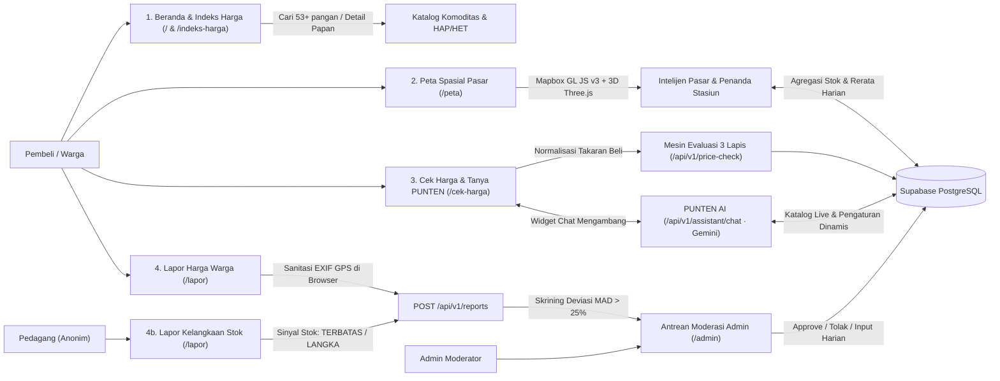

<div align="center">

  <h1>PasarKu</h1>
  <p><strong>Alat Bantu Keputusan Harga Pangan Rakyat &amp; Intelijen Pasar Tradisional</strong></p>
  <p><em>"Tahu harga sebelum ke pasar, beli tenang tanpa menebak."</em></p>

  <p>
    
    
    
    
    
    
  </p>

  <p>
    <a href="#sekilas">Sekilas Proyek</a> &middot;
    <a href="#fitur-unggulan">Fitur Utama</a> &middot;
    <a href="#system-flow">System Flow (Juri)</a> &middot;
    <a href="#lorong-3d">Lorong 3D &amp; Suara</a> &middot;
    <a href="#mesin-3-lapis">Mesin 3 Lapis</a> &middot;
    <a href="#rute-halaman">Peta Rute &amp; API</a> &middot;
    <a href="#arsitektur-teknis">Arsitektur &amp; Database</a> &middot;
    <a href="#jalankan-lokal">Instalasi Lokal</a>
  </p>

</div>

<hr />

<h2 id="sekilas">Sekilas Proyek &amp; Posisi PasarKu</h2>

<p>
  <strong>PasarKu</strong> adalah platform web modern berbasis transparansi harga pangan pasar rakyat yang menjembatani kesenjangan informasi antara data makro pemerintah dan kebutuhan transaksi mikro harian pembeli serta pedagang di pasar tradisional.
</p>

<p>
  Platform ini dirancang khusus untuk kompetisi <strong>Web In Action (MIA 2026)</strong> dengan pilot implementasi <strong>Fase 1 Kota Bogor</strong> (13 unit pasar di bawah naungan Perumda Pasar Pakuan Jaya) dan siap berekspansi ke skala aglomerasi Jabodetabek, Jawa Barat, hingga Nasional lintas 6 koridor pulau besar.
</p>

<table>
  <thead>
    <tr>
      <th width="50%" align="left">Tantangan Lapangan di Pasar Rakyat</th>
      <th width="50%" align="left">Solusi Terintegrasi PasarKu</th>
    </tr>
  </thead>
  <tbody>
    <tr>
      <td valign="top">
        <ul>
          <li><strong>Data Makro Sulit Dipakai Eceran:</strong> Publikasi resmi (PIHPS Bank Indonesia &amp; Panel Harga Bapanas) menyajikan harga per kilogram secara agregat, sedangkan pembeli rumah tangga bertransaksi dalam takaran eceran (<code>1/4 kg</code>, <code>1/2 kg</code>, <code>1 ons</code>, <code>1 ikat</code>).</li>
          <li><strong>Disparitas &amp; Ketidakpastian Harga:</strong> Pembeli tidak mengetahui apakah tawaran pedagang tergolong wajar atau kemahalan sebelum tiba di lapak.</li>
          <li><strong>Informasi Stok Terlambat:</strong> Kelangkaan bahan pangan di pasar tertentu (misalnya pasar dekat stasiun kereta) sering terlambat terdeteksi oleh warga.</li>
          <li><strong>Privasi Pelapor Terancam:</strong> Warga enggan melapor harga riil karena khawatir identitas atau lokasi rumahnya terlacak via metadata foto.</li>
        </ul>
      </td>
      <td valign="top">
        <ul>
          <li><strong>Kalkulasi Takaran Nyata:</strong> Mesin kalkulator menormalkan satuan belanja ke nominal Rupiah riil seketika dan memberikan rekomendasi rentang tawar aman.</li>
          <li><strong>Mesin Evaluasi 3 Lapis:</strong> Menguji kewajaran harga terhadap Acuan HAP/HET Bapanas, Survei Harian Pasar Daerah, dan Laporan Warga Terverifikasi.</li>
          <li><strong>Crowdsourcing Dua Arah Anonim:</strong> Membuka jalur pelaporan harga warga (dengan sanitasi metadata EXIF GPS otomatis di browser) serta jalur sinyal stok pedagang tanpa mencatat nama kios.</li>
          <li><strong>Simulasi Belanja 3D &amp; AI:</strong> Lorong pasar 3D imersif dan asisten cerdas PUNTEN AI yang siap diajak berkonsultasi mengenai strategi belanja hemat.</li>
        </ul>
      </td>
    </tr>
  </tbody>
</table>

<hr />

<h2 id="fitur-unggulan">6 Pilar Fitur Utama PasarKu</h2>

<table>
  <thead>
    <tr>
      <th width="28%" align="left">Pilar Fitur</th>
      <th width="44%" align="left">Deskripsi &amp; Mekanisme Kerja</th>
      <th width="28%" align="left">Manfaat Bagi Pengguna</th>
    </tr>
  </thead>
  <tbody>
    <tr>
      <td><strong>1. Lorong Pasar 3D WebGL &amp; Audio</strong></td>
      <td>
        Simulasi 3D Three.js menyusuri lorong 20 lapak komoditas:
        <ul>
          <li>Rig tangan kiri memegang keranjang anyaman bambu (mulai kosong).</li>
          <li>Rig tangan kanan menjangkau dan mengambil barang yang diklik di lapak.</li>
          <li>Klik item di keranjang untuk mengeluarkannya tanpa buka modal.</li>
          <li>Pandangan bebas 360&deg; (drag mouse/touch, keyboard &larr;/&rarr; atau Q/E, tombol Hadap Depan).</li>
          <li>Tata suara prosedural Web Audio API murni (langkah kaki, petikan, jatuhan keranjang) &amp; musik pentatonis Pelog/Slendro instan.</li>
        </ul>
      </td>
      <td>Pengalaman belanja pasar tradisional yang interaktif, menyenangkan, dan edukatif langsung di peramban web.</td>
    </tr>
    <tr>
      <td><strong>2. Indeks 53+ Komoditas Strategis</strong></td>
      <td>
        Katalog komoditas pangan lengkap dengan filter 5 kategori utama (Beras, Cabai &amp; Bawang, Daging &amp; Telur, Minyak &amp; Gula, Sayur &amp; Buah), pencarian instan, chip kata kunci cepat, pengurutan harga, perbandingan langsung terhadap HAP/HET Bapanas RI, serta toggle tampilan kartu atau tabel.
      </td>
      <td>Mengetahui acuan harga resmi pemerintah sebelum berangkat ke pasar agar tidak mudah tertipu harga tinggi.</td>
    </tr>
    <tr>
      <td><strong>3. Cek Harga Kasir &amp; PUNTEN AI</strong></td>
      <td>
        Kalkulator belanja eceran: masukkan barang, pasar, takaran beli (1 kg, 1/2 kg, 1/4 kg, 1 ons), dan harga tawaran penjual. Sistem mengklasifikasikan status kewajaran (Wajar, Agak Mahal, Terlalu Mahal, Jauh Lebih Murah) dan menampilkan batas tawar yang aman.
        <br /><br />
        Didukung <strong>Widget Chatbot PUNTEN AI</strong> mengambang di pojok kanan bawah (Google Gemini) yang siap diajak berkonsultasi mengenai komparasi harga dan tips menawar.
      </td>
      <td>Keputusan belanja instan di depan lapak dalam hitungan detik beserta panduan tawar-menawar yang santun dan realistis.</td>
    </tr>
    <tr>
      <td><strong>4. Peta Spasial 3D 13 Pasar Bogor</strong></td>
      <td>
        Visualisasi geospasial berbasis <strong>Mapbox GL JS v3</strong> dan layer bangunan pasar 3D Three.js:
        <ul>
          <li>Mencakup seluruh 13 pasar binaan Perumda Pasar Pakuan Jaya Kota Bogor.</li>
          <li>Penanda khusus pasar dekat koridor transportasi (Stasiun Bogor).</li>
          <li>Drawer filter komoditas, peringkat pasar termurah ke termahal, dan sinyal kelangkaan pasokan.</li>
          <li>Mode Ringan (tabel alternatif) ramah kuota dan perangkat hemat daya.</li>
        </ul>
      </td>
      <td>Menemukan unit pasar terdekat dengan harga paling wajar dan ketersediaan stok paling aman.</td>
    </tr>
    <tr>
      <td><strong>5. Lapor Partisipatif Dua Arah Anonim</strong></td>
      <td>
        Mekanisme pelaporan transparan tanpa rasa takut:
        <ul>
          <li><strong>Jalur Warga (PRICE):</strong> Laporkan harga transaksi riil beserta foto bukti nota/timbangan. Seluruh <strong>metadata EXIF dan koordinat GPS disanitasi otomatis di browser</strong> sebelum berkas dikirim ke server.</li>
          <li><strong>Jalur Pedagang (SHORTAGE):</strong> Pedagang mengabarkan status stok barang (Terbatas, Langka, Pulih) secara anonim tanpa mencatat nama kios.</li>
          <li>Deteksi anomali otomatis menggunakan formula Median Absolute Deviation (MAD &gt; 25%).</li>
        </ul>
      </td>
      <td>Membangun basis data harga berbasis komunitas yang akurat, terverifikasi, dan menjamin perlindungan privasi 100%.</td>
    </tr>
    <tr>
      <td><strong>6. Konsol Moderasi &amp; Konfigurasi Admin</strong></td>
      <td>
        Antarmuka terproteksi sesi admin di <code>/admin</code> untuk:
        <ul>
          <li>Meninjau dan menyetujui/menolak antrean laporan warga yang berstatus pending/anomaly.</li>
          <li>Entri cepat harga survei harian (<code>daily_prices</code>) per pasar.</li>
          <li>Manajemen data master komoditas dan pasar (CRUD).</li>
          <li>Pengaturan dinamis API Key Gemini, model AI, instruksi sistem, dan Token Mapbox dari database tanpa perlu redeploy aplikasi.</li>
        </ul>
      </td>
      <td>Menjaga integritas data publik, mencegah spam, serta memudahkan pengelola memperbarui konfigurasi sistem secara fleksibel.</td>
    </tr>
  </tbody>
</table>

<hr />

<h2 id="system-flow">System Flow End-to-End (Untuk Penilaian Juri)</h2>

<p>
  Diagram berikut merangkum alur interaksi pengguna, pemrosesan data, integrasi AI, serta moderasi pada Supabase PostgreSQL:
</p>



<hr />

<h2 id="lorong-3d">Pengalaman Interaktif: Lorong Pasar 3D &amp; Tata Suara Web Audio</h2>

<p>
  Lorong Pasar 3D menghadirkan pengalaman visual pasar tradisional yang otentik lengkap dengan ornamen kain atap, papan komoditas gantung, gerbang kayu, serta tata suara prosedural Web Audio API murni tanpa beban aset file eksternal.
</p>

<table>
  <thead>
    <tr>
      <th width="30%" align="left">Fitur Lorong 3D</th>
      <th width="40%" align="left">Mekanisme Interaksi</th>
      <th width="30%" align="left">Kontrol &amp; Pintasan</th>
    </tr>
  </thead>
  <tbody>
    <tr>
      <td><strong>POV Dua Tangan Interaktif</strong></td>
      <td>
        <strong>Tangan Kiri:</strong> Memegang keranjang anyaman bambu berkapasitas hingga 7 barang (mulai dalam kondisi kosong).<br />
        <strong>Tangan Kanan:</strong> Meraih dan mengambil komoditas yang diklik di lapak ke dalam keranjang dengan animasi 3-fase (<em>reach</em>, <em>carry</em>, <em>drop</em>) sebelum membuka modal rincian harga.
      </td>
      <td>Klik lapak pedagang untuk mengambil barang ke keranjang.</td>
    </tr>
    <tr>
      <td><strong>Keluarkan Komoditas dari Keranjang</strong></td>
      <td>
        Komoditas yang sudah terkumpul di keranjang dapat diklik langsung untuk dikeluarkan (animasi melayang keluar dan menyusut disertai efek suara <em>pop/whoosh</em>) tanpa memicu modal rincian harga.
      </td>
      <td>Klik item di dalam keranjang bambu.</td>
    </tr>
    <tr>
      <td><strong>Pandangan Bebas 360&deg;</strong></td>
      <td>
        Kamera dapat diputar ke segala arah (kiri, kanan, atas, bawah, hingga 180&deg; ke pintu gerbang belakang) dengan kehalusan <em>Euler damping</em>. Papan komoditas gantung dibuat dua sisi agar nama dan ikon komoditas tetap terbaca tegak saat dilihat dari arah belakang.
      </td>
      <td>
        <strong>Mouse / Touch:</strong> Seret kanvas secara horizontal/vertikal.<br />
        <strong>Keyboard:</strong> <code>&larr;</code> / <code>Q</code> (hadap kiri), <code>&rarr;</code> / <code>E</code> (hadap kanan).<br />
        <strong>Reset:</strong> Tombol <code>Hadap Depan</code> atau tekan <code>R</code>.
      </td>
    </tr>
    <tr>
      <td><strong>Navigasi Jalan Menyusuri Lorong</strong></td>
      <td>
        Melangkah menyusuri 20 lapak komoditas interaktif dengan kamera terkontrol mulus tanpa konflik antara scroll vertikal dan gestur rotasi pandangan.
      </td>
      <td>
        <strong>Keyboard:</strong> <code>&uarr;</code> (langkah maju), <code>&darr;</code> (langkah mundur).<br />
        <strong>Scroll / Wheel:</strong> Gulir vertikal mouse atau touchpad.
      </td>
    </tr>
    <tr>
      <td><strong>Tata Suara Web Audio API Prosedural</strong></td>
      <td>
        Sintesis audio prosedural tanpa file audio MP3/WAV: deru pasar hangat, langkah kaki ritmis saat jalan, petikan reaktif saat mengambil barang, dentum jatuhnya komoditas di keranjang, dan loop melodi gamelan pentatonis skala Pelog/Slendro yang otomatis berputar seketika saat masuk lorong.
      </td>
      <td>Tombol toggle suara HUD: <code>Bisu</code> &harr; <code>Suara Aktif</code>.</td>
    </tr>
  </tbody>
</table>

<hr />

<h2 id="mesin-3-lapis">Mesin Evaluasi 3 Lapis &amp; Cakupan Rollout 4 Fase</h2>

<table>
  <thead>
    <tr>
      <th width="52%" align="left">Arsitektur 3 Lapis Harga (<code>evaluatePrice</code>)</th>
      <th width="48%" align="left">Strategi Ekspansi Wilayah 4 Fase</th>
    </tr>
  </thead>
  <tbody>
    <tr>
      <td valign="top">
        <p><strong>Prioritas Pembanding Harga:</strong></p>
        <ol>
          <li><strong>Lapis 1 (Acuan Nasional Terkalibrasi):</strong> Batas HAP/HET Bapanas RI disesuaikan indeks logistik wilayah (<code>1.00x</code> Pulau Jawa s.d. <code>1.28x</code> Maluku-Papua).</li>
          <li><strong>Lapis 2 (Survei Pasar Resmi):</strong> Rata-rata survei harian pasar daerah (PIHPS Bank Indonesia &amp; Perumda Pasar Pakuan Jaya) pada <code>daily_prices</code>.</li>
          <li><strong>Lapis 3 (Laporan Warga Terverifikasi):</strong> Median laporan <code>APPROVED</code> di pasar terpilih (minimal 2 laporan) atau fallback median kota/wilayah.</li>
        </ol>
        <p><strong>Klasifikasi Status Tawaran:</strong></p>
        <ul>
          <li><code>&lt; -15%</code> : <strong>Jauh Lebih Murah</strong> (cek mutu &amp; timbangan barang)</li>
          <li><code>-10% s.d. +10%</code> : <strong>Wajar</strong> (sesuai kisaran transaksi riil daerah)</li>
          <li><code>+10% s.d. +25%</code> : <strong>Agak Mahal</strong> (disarankan melakukan penawaran)</li>
          <li><code>&gt; +25%</code> : <strong>Terlalu Mahal</strong> (melebihi batas toleransi wajar)</li>
        </ul>
      </td>
      <td valign="top">
        <p>Pemilih fase terpusat di <strong>Top Navbar</strong> mengatur konteks wilayah di seluruh halaman:</p>
        <table>
          <thead>
            <tr>
              <th align="left">Fase</th>
              <th align="left">Cakupan Aktif</th>
              <th align="left">Fokus Data &amp; Pasar</th>
            </tr>
          </thead>
          <tbody>
            <tr>
              <td><code>F1</code></td>
              <td><strong>Kota Bogor</strong></td>
              <td>Pilot aktif <strong>13 unit pasar</strong> Perumda PPJ (Kebon Kembang/Anyar, Devries, Merdeka, Sukasari, Bogor Castle, dll).</td>
            </tr>
            <tr>
              <td><code>F2</code></td>
              <td><strong>Jabodetabek</strong></td>
              <td>Aglomerasi konsumen DKI Jakarta, Bogor, Depok, Tangerang, dan Bekasi.</td>
            </tr>
            <tr>
              <td><code>F3</code></td>
              <td><strong>Jawa Barat</strong></td>
              <td>Sentra produksi hortikultura dan pasar rakyat Jawa Barat.</td>
            </tr>
            <tr>
              <td><code>F4</code></td>
              <td><strong>Nasional</strong></td>
              <td><strong>23 wilayah strategis</strong> lintas <strong>6 koridor pulau</strong> dan <strong>74 pasar</strong> dengan indeks disparitas logistik.</td>
            </tr>
          </tbody>
        </table>
      </td>
    </tr>
  </tbody>
</table>

<hr />

<h2 id="rute-halaman">Peta Rute Halaman &amp; Kontrak API</h2>

<table>
  <thead>
    <tr>
      <th width="18%" align="left">Rute Halaman</th>
      <th width="26%" align="left">Nama Modul</th>
      <th width="56%" align="left">Fitur &amp; Fungsi Utama</th>
    </tr>
  </thead>
  <tbody>
    <tr>
      <td><code>/</code></td>
      <td><strong>Beranda PasarKu</strong></td>
      <td>Hero ornamen tradisional Sunda/Bogor, Lorong Pasar 3D interaktif Three.js (POV 2 tangan, keranjang bambu, 360&deg;, tata suara Web Audio), Papan Acuan 10 Komoditas Cepat, Tanya Jawab singkat, Peta 3D 13 Pasar Bogor, dan floating widget PUNTEN AI.</td>
    </tr>
    <tr>
      <td><code>/indeks-harga</code></td>
      <td><strong>Indeks Harga Lengkap</strong></td>
      <td>Katalog lengkap 53+ bahan pangan, bilah pencarian cerdas, chip kata kunci populer, penyaring kategori, pengurutan harga, modal komparasi HAP/HET, serta toggle tampilan tabel/kartu.</td>
    </tr>
    <tr>
      <td><code>/cek-harga</code></td>
      <td><strong>Cek Harga &amp; PUNTEN AI</strong></td>
      <td>Kalkulator takaran belanja harian (konversi takaran ke harga nyata), analisis selisih Rupiah terhadap 3 lapis harga, rekomendasi rentang tawar aman, serta integrasi chat PUNTEN AI.</td>
    </tr>
    <tr>
      <td><code>/peta</code></td>
      <td><strong>Peta Harga Spasial</strong></td>
      <td>Kanvas penuh Mapbox GL JS v3, drawer filter komoditas, peringkat pasar termurah ke termahal, indikator kedekatan stasiun, dan Mode Ringan alternatif tabel.</td>
    </tr>
    <tr>
      <td><code>/lapor</code></td>
      <td><strong>Lapor Lapangan Dua Arah</strong></td>
      <td>Formulir pelaporan harga riil warga (sanitasi metadata EXIF GPS otomatis di browser) dan pelaporan status ketersediaan stok pedagang (anonim tanpa nama kios).</td>
    </tr>
    <tr>
      <td><code>/dashboard</code></td>
      <td><strong>Dashboard Tren</strong></td>
      <td>Grafik tren sparkline 14 hari, visualisasi fluktuasi komoditas strategis, dan komparasi harga antar wilayah.</td>
    </tr>
    <tr>
      <td><code>/tentang</code></td>
      <td><strong>Tentang &amp; Metodologi</strong></td>
      <td>Penjelasan transparansi metodologi evaluasi 3 lapis harga, sumber data resmi (PIHPS, Bapanas, Perumda PPJ), dan disclaimer data simulasi.</td>
    </tr>
    <tr>
      <td><code>/admin</code></td>
      <td><strong>Konsol Moderasi Admin</strong></td>
      <td>Autentikasi sesi admin, moderasi antrean laporan warga/pedagang, entri cepat harga survei harian, manajemen data komoditas &amp; pasar, dan konfigurasi API Key dinamis.</td>
    </tr>
  </tbody>
</table>

<details>
  <summary><strong>Lihat Daftar Endpoint REST API (<code>/api/v1/*</code>)</strong></summary>
  <br />
  <table>
    <thead>
      <tr>
        <th width="12%" align="left">Method</th>
        <th width="34%" align="left">Endpoint</th>
        <th width="54%" align="left">Deskripsi Fungsi</th>
      </tr>
    </thead>
    <tbody>
      <tr><td><code>GET</code></td><td><code>/api/v1/regions</code></td><td>Daftar wilayah/provinsi 6 koridor pulau dengan filter phase, island, dan pencarian nama.</td></tr>
      <tr><td><code>GET</code></td><td><code>/api/v1/commodities</code></td><td>Katalog master komoditas aktif dan agregasi harga harian per wilayah dari Supabase.</td></tr>
      <tr><td><code>GET</code></td><td><code>/api/v1/commodities/[slug]</code></td><td>Rincian komoditas spesifik beserta riwayat fluktuasi dan perbandingan batas HAP/HET.</td></tr>
      <tr><td><code>GET</code></td><td><code>/api/v1/markets</code></td><td>Daftar unit pasar tradisional per wilayah lengkap dengan koordinat spasial dan flag stasiun.</td></tr>
      <tr><td><code>GET</code></td><td><code>/api/v1/markets/insights</code></td><td>Agregasi komoditas mahal (deviasi &gt; 10%) dan sinyal kelangkaan pasokan per unit pasar.</td></tr>
      <tr><td><code>POST</code></td><td><code>/api/v1/price-check</code></td><td>Normalisasi takaran eceran dan evaluasi kewajaran tawaran terhadap 3 lapis acuan harga.</td></tr>
      <tr><td><code>GET / POST</code></td><td><code>/api/v1/reports</code></td><td>Mengambil laporan terverifikasi atau mengirim laporan harga baru dengan kalkulasi deviasi MAD.</td></tr>
      <tr><td><code>POST</code></td><td><code>/api/v1/assistant/chat</code></td><td>Sesi percakapan cerdas PUNTEN AI (Google Gemini) berkonteks katalog harga riil terkini.</td></tr>
      <tr><td><code>GET</code></td><td><code>/api/v1/map/config</code></td><td>Menyajikan token publik Mapbox GL JS secara aman dan dinamis dari tabel database.</td></tr>
      <tr><td><code>GET / POST / PUT</code></td><td><code>/api/v1/admin/*</code></td><td>Endpoint operasional admin: autentikasi, sinkronisasi data, entri harga, dan pengaturan sistem.</td></tr>
    </tbody>
  </tbody>
</table>
</details>

<hr />

<h2 id="arsitektur-teknis">Arsitektur Teknis, Skema Database &amp; Struktur Proyek</h2>

<table>
  <thead>
    <tr>
      <th width="25%" align="left">Lapisan Sistem</th>
      <th width="75%" align="left">Teknologi &amp; Pendekatan Implementasi</th>
    </tr>
  </thead>
  <tbody>
    <tr>
      <td><strong>Frontend &amp; Desain</strong></td>
      <td>Next.js 16 (App Router), React 19.3, TypeScript 5.7 Strict Mode, Tailwind CSS v4, tipografi tunggal Google Fonts Ubuntu, Dual-Theme (Mode Siang &amp; Mode Subuh), Phosphor Icons, ornamen budaya Sunda/Bogor.</td>
    </tr>
    <tr>
      <td><strong>Grafis 3D &amp; Spasial</strong></td>
      <td>Three.js WebGL (Lorong Pasar 3D 360&deg; dengan rig POV ganda, keranjang bambu interaktif, tata suara prosedural Web Audio API, Maskot 3D PUNTEN, dan Custom 3D Layer bangunan pasar) terintegrasi bersama Mapbox GL JS v3.</td>
    </tr>
    <tr>
      <td><strong>Backend &amp; Database</strong></td>
      <td>Next.js Route Handlers (<code>/api/v1/*</code>) terhubung ke PostgreSQL Supabase via Session Pooler <code>pg</code> dengan kueri SQL berparameter (zero external ORM) dan fallback data terkurasi otomatis saat koneksi offline.</td>
    </tr>
    <tr>
      <td><strong>AI &amp; Privasi</strong></td>
      <td>Google Gemini API (kunci API dikelola dinamis di tabel <code>system_settings</code> server-only), sanitasi metadata EXIF/GPS di sisi klien sebelum foto dikirim, serta agregasi sinyal stok di level pasar tanpa mencatat nama lapak/kios.</td>
    </tr>
  </tbody>
</table>

<details>
  <summary><strong>Lihat Struktur Folder &amp; Skema 6 Tabel PostgreSQL (<code>supabase/schema.sql</code>)</strong></summary>
  <br />
  <pre><code>PasarKu/
├── src/
│   ├── app/                  # Rute App Router (/, /indeks-harga, /cek-harga, /peta, /lapor, /dashboard, /tentang, /admin) + API /api/v1/*
│   ├── components/           # Komponen UI: landing/pasarku (3D Lorong &amp; Unit Pasar), indeks, price, peta, lapor, assistant, admin, ornament
│   ├── lib/                  # Logika 3 lapis harga, fetcher API, koneksi pg DB, store context, seed data &amp; wilayah
│   └── types/                # Kontrak tipe TypeScript eksplisit (zero any)
├── supabase/schema.sql       # DDL PostgreSQL + Row Level Security (regions, commodities, markets, daily_prices, citizen_reports, system_settings)
├── scripts/                  # Seeder Supabase UNNEST (init-supabase-db.mjs) &amp; suite uji otomatis (verify-test-matrix.mjs, verify-admin-*.mjs, verify-corridor-interaction.mjs)
├── public/                   # Aset gambar, ikon, dan ornamen lokal PasarKu
├── .env.example              # Template variabel lingkungan
└── README.md                 # Dokumentasi proyek &amp; panduan teknis</code></pre>
  <table>
    <thead>
      <tr>
        <th width="25%" align="left">Tabel PostgreSQL</th>
        <th width="75%" align="left">Peran &amp; Struktur Data</th>
      </tr>
    </thead>
    <tbody>
      <tr><td><code>regions</code></td><td>23 wilayah administratif lintas 6 koridor pulau dengan metadata <code>phase</code> (1-4), <code>logistics_cost_pct</code>, dan <code>disparity_index</code>.</td></tr>
      <tr><td><code>commodities</code></td><td>Master bahan pangan strategis, kategori, satuan takaran standar, ambang toleransi kewajaran, dan acuan <code>hap_het_price</code>.</td></tr>
      <tr><td><code>markets</code></td><td>Daftar pasar tradisional binaan Perumda PPJ Bogor &amp; nasional, koordinat geospasial, jam operasional, dan penanda <code>near_station</code>.</td></tr>
      <tr><td><code>daily_prices</code></td><td>Matriks survei harga harian resmi per kombinasi <code>(market_id, commodity_id)</code> untuk evaluasi Lapis 2.</td></tr>
      <tr><td><code>citizen_reports</code></td><td>Laporan riil warga (<code>PRICE</code>) dan pedagang (<code>SHORTAGE</code>), deviasi MAD, status moderasi, dan verifikasi <code>exif_sanitized</code>.</td></tr>
      <tr><td><code>system_settings</code></td><td>Konfigurasi dinamis server-only: <code>gemini_api_key</code>, <code>gemini_model</code>, instruksi sistem PUNTEN, dan <code>mapbox_access_token</code>.</td></tr>
    </tbody>
  </table>
</details>

<hr />

<h2 id="jalankan-lokal">Panduan Menjalankan di Komputer Lokal</h2>

<h3>1. Prasyarat Sistem</h3>
<ul>
  <li><strong>Node.js &gt;= 20.x</strong> (disarankan Node 22+ agar dukungan <code>--experimental-strip-types</code> berjalan natif)</li>
  <li>Database PostgreSQL / <strong>Supabase</strong> (atau jalankan dengan mode fallback terkurasi bawaan via <code>NEXT_PUBLIC_USE_MOCK="true"</code>)</li>
</ul>

<h3>2. Instalasi &amp; Konfigurasi</h3>

```bash
# Masuk ke direktori repositori
cd PasarKu

# Pasang seluruh dependensi proyek
npm install

# Salin template variabel lingkungan
cp .env.example .env.local
```

<p>Sesuaikan variabel di <code>.env.local</code> berdasarkan template <a href=".env.example"><code>.env.example</code></a>:</p>
<ul>
  <li><code>DATABASE_URL</code>, <code>NEXT_PUBLIC_SUPABASE_URL</code>, <code>NEXT_PUBLIC_SUPABASE_ANON_KEY</code> (koneksi database Supabase PostgreSQL)</li>
  <li><code>ADMIN_SESSION_SECRET</code> (string acak minimal 32 karakter untuk sesi aman panel <code>/admin</code>)</li>
  <li><code>NEXT_PUBLIC_APP_URL</code>, <code>NEXT_PUBLIC_API_URL</code>, <code>NEXT_PUBLIC_USE_MOCK</code> (pengaturan URL aplikasi dan fallback data offline)</li>
  <li><code>GEMINI_API_KEY</code> &amp; <code>NEXT_PUBLIC_MAPBOX_TOKEN</code> (opsional sebagai cadangan jika belum diisi dari panel admin)</li>
</ul>

<h3>3. Inisialisasi Database &amp; Jalankan Server Lokal</h3>

```bash
# Inisialisasi schema tabel & seed data master ke Supabase
node --experimental-strip-types scripts/init-supabase-db.mjs

# Jalankan server pengembangan lokal Next.js
npm run dev
```

<p>Buka peramban di alamat <a href="http://localhost:3000"><code>http://localhost:3000</code></a>.</p>

<h3>4. Pemeriksaan Kualitas &amp; Suite Uji Otomatis</h3>

```bash
npm run typecheck    # Verifikasi tipe TypeScript ketat (zero error)
npm test             # Jalankan suite uji kalkulasi harga 3 lapis, store admin, auth, & interaksi lorong 3D
npm run build        # Bangun artefak produksi Next.js (--webpack)
```

<hr />

<blockquote>
  <strong>Catatan Integritas Data &amp; Privasi:</strong> Seluruh data simulasi untuk keperluan demonstrasi diberi penanda visual yang transparan. PasarKu selalu mencantumkan rujukan sumber data resmi (Bapanas RI &amp; PIHPS Bank Indonesia), membersihkan metadata EXIF GPS dari foto unggahan warga langsung di sisi browser, serta mengagregasi sinyal stok pedagang di level pasar tanpa mengekspos identitas kios perseorangan.
</blockquote>
