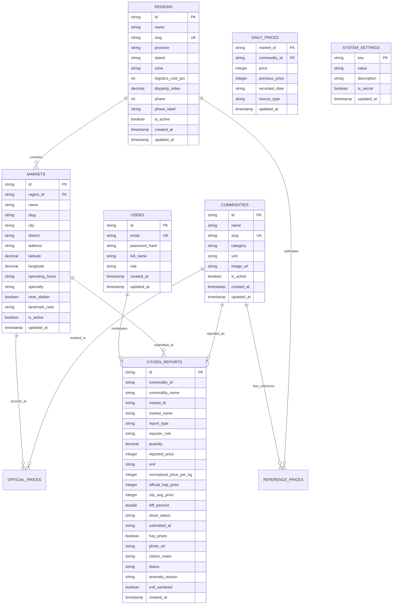

# SCHEMA.md — Database Architecture & Data Dictionary

Dokumen ini adalah **Single Source of Truth (SSOT)** untuk seluruh struktur data, tabel, relasi, indeks, dan tipe data database pada proyek **HargaKu**.

> [!IMPORTANT]
> **Aturan Wajib**: Dilarang membuat migration Prisma (`prisma migrate`, `db push`) sebelum perubahan model disepakati dan dicatat di dokumen ini.

---

## 1. Konvensi & Standar Database

| Aspek | Standar yang Digunakan | Keterangan |
| :--- | :--- | :--- |
| **Engine** | PostgreSQL 17 (Supabase) | Diakses melalui Supavisor Session Pooler (`pg` Pool) dengan parameterized SQL |
| **Penamaan Tabel** | `snake_case`, plural | `regions`, `commodities`, `markets`, `daily_prices`, `citizen_reports`, `system_settings` |
| **Penamaan Kolom** | `snake_case` | `commodity_id`, `market_id`, `reported_price`, `report_type`, `stock_status`, `recorded_date` |
| **Primary Key** | String slug/ID terstandarisasi (`TEXT`) | misal `reg_bogor`, `cabai-rawit-merah`, `mkt_kebon_kembang` |
| **Mata Uang & Nominal**| `INTEGER` | Disimpan dalam satuan Rupiah bulat (misal: `15000` untuk Rp 15.000) |
| **Timestamps** | Wajib ada di setiap tabel | `created_at TIMESTAMPTZ`, `updated_at TIMESTAMPTZ` |
| **Zona Waktu** | UTC di database, konversi ke `Asia/Jakarta (WIB)` di presentation layer |

---

## 2. Entity Relationship Diagram (ERD)

---

## 3. Data Dictionary & Kamus Kolom

### 3.1. Tabel `regions`
Menyimpan daftar wilayah acuan 4 fase (`Kota Bogor`, `Jabodetabek`, `Jawa Barat`, dan 21 provinsi `Nasional`) berdasarkan koridor pulau, zonasi Bapanas, dan persentase toleransi biaya logistik kargo laut.
* `id` (TEXT, PK): ID unik wilayah (misal `reg_bogor`, `reg_bodebek`, `reg_jabar`, `reg_jakarta`, `reg_kaltim`).
* `name` (TEXT, NOT NULL): Nama wilayah/provinsi.
* `slug` (TEXT, UNIQUE): URL slug wilayah (`kota-bogor`, `jabodetabek`, `jawa-barat`, dll.).
* `province` (TEXT, NULL): Provinsi induk (misal: `Jawa Barat` untuk `reg_bogor`).
* `island` (TEXT, NOT NULL): Koridor pulau logistik (`JAWA`, `SUMATERA`, `KALIMANTAN`, `SULAWESI`, `BALI_NUSRA`, `MALUKU_PAPUA`).
* `island_name` (TEXT, NOT NULL): Nama koridor tampil UI.
* `zone` (TEXT, NOT NULL, DEFAULT 'ZONA_1'): Zonasi pangan Bapanas (`ZONA_1`, `ZONA_2`, `ZONA_3`).
* `logistics_cost_pct` (INTEGER, DEFAULT 0): Toleransi biaya logistik kargo laut resmi Bapanas.
* `disparity_index` (DOUBLE PRECISION, DEFAULT 1.0): Koefisien pengali harga acuan nasional (`1 + logistics_cost_pct / 100`).
* `phase` (INTEGER, NOT NULL, DEFAULT 4): Urutan fase rollout (`1` Bogor -> `2` Jabodetabek -> `3` Jawa Barat -> `4` Nasional).
* `phase_label` (TEXT, NOT NULL): Label fase tampil UI (`Fase 1 · Kota Bogor`, `Fase 2 · Jabodetabek`, `Fase 3 · Jawa Barat`, `Fase 4 · Nasional`).
* `is_active` (BOOLEAN, DEFAULT true): Status keaktifan wilayah.
* `updated_at` (TIMESTAMPTZ).

### 3.2. Tabel `commodities`
Menyimpan daftar bahan pokok strategis yang dipantau (12–15 komoditas).
* `id` (VARCHAR/CUID, PK): ID unik komoditas.
* `name` (VARCHAR(100), NOT NULL): Nama bahan pangan (misal: "Cabai Rawit Merah", "Minyak Goreng MinyaKita").
* `slug` (VARCHAR(120), UNIQUE): URL-friendly slug (misal: `cabai-rawit-merah`).
* `category` (VARCHAR(50), NOT NULL): Kategori pangan (`BERAS`, `CABAI_BAWANG`, `DAGING_UNGGAS`, `MINYAK_GULA`, `SAYURAN`).
* `unit` (VARCHAR(20), NOT NULL): Satuan standar (`kg`, `liter`, `butir`).
* `image_url` (VARCHAR(255), NULL): URL aset foto komoditas.
* `is_active` (BOOLEAN, DEFAULT true): Flag status aktif komoditas.
* `created_at` / `updated_at` (TIMESTAMPTZ).

### 3.3. Tabel `markets`
Menyimpan daftar pasar tradisional (13 unit Perumda PPJ Kota Bogor dan sentra daerah/nasional).
* `id` (TEXT, PK): ID unik pasar.
* `region_id` (TEXT, NOT NULL): Relasi ke `regions.id`.
* `name` (TEXT, NOT NULL): Nama pasar (misal: "Pasar Kebon Kembang (Pasar Anyar)", "Pasar Devries").
* `slug` (TEXT, NOT NULL): URL slug pasar (`kebon-kembang`, `devries`).
* `city` (TEXT, NOT NULL): Nama kota/kabupaten.
* `district` (TEXT, NOT NULL): Nama kecamatan.
* `address` (TEXT, NOT NULL): Alamat lengkap pasar.
* `latitude` / `longitude` (DOUBLE PRECISION, NOT NULL): Koordinat geospasial.
* `operating_hours` (TEXT): Jam operasional pasar.
* `specialty` (TEXT): Karakteristik/profil pasar.
* `near_station` (BOOLEAN, DEFAULT false): Penanda pasar dekat Stasiun Bogor (`Kebon Kembang/Anyar`, `Devries`, `Merdeka`).
* `landmark_note` (TEXT, NULL): Keterangan kedekatan simpul transportasi (misal: `"±350m dari Stasiun Bogor"`).
* `is_active` (BOOLEAN, DEFAULT true): Status aktif pasar dalam sistem.
* `updated_at` (TIMESTAMPTZ).

### 3.4. Tabel `reference_prices` (Lapis 1 — Standarisasi Nasional HAP / HET Terkalibrasi)
Menyimpan ketetapan harga acuan resmi dari Badan Pangan Nasional berdasarkan zonasi wilayah.
* `id` (VARCHAR/CUID, PK): ID unik acuan harga.
* `commodity_id` (VARCHAR, FK ➔ `commodities.id`): Relasi komoditas.
* `zone` (VARCHAR(20), NOT NULL, DEFAULT 'ZONA_1'): Zonasi wilayah regulasi Bapanas (`ZONA_1`, `ZONA_2`, `ZONA_3`).
* `price_hap_het` (INTEGER, NOT NULL): Nominal batas acuan dalam Rupiah untuk zona tersebut.
* `disparity_multiplier` (DECIMAL(4, 3), DEFAULT 1.000): Pengali penyesuaian disparitas wilayah.
* `reference_type` (VARCHAR(20), NOT NULL): Tipe regulasi (`HAP` atau `HET`).
* `legal_doc_no` (VARCHAR(150), NOT NULL): Nomor dasar hukum peraturan (misal: "Perbadan No 17 Tahun 2023").
* `valid_from` (DATE, NOT NULL): Tanggal mulai berlaku regulasi.
* `valid_to` (DATE, NULL): Tanggal berakhir (NULL bila masih aktif).

### 3.5. Tabel `daily_prices` (Lapis 2 — Survei Pasar Harian PIHPS / PPJ / Admin)
Menyimpan harga survei harian per komoditas dan pasar (`PRIMARY KEY (market_id, commodity_id)`).
* `market_id` (TEXT, FK ➔ `markets.id`).
* `commodity_id` (TEXT, FK ➔ `commodities.id`).
* `price` (INTEGER, NOT NULL): Nominal harga harian dalam Rupiah (`/kg` atau satuan dasar).
* `previous_price` (INTEGER, NULL): Harga pencatatan sebelumnya untuk menghitung persentase perubahan harian.
* `recorded_date` (TEXT, NOT NULL): Tanggal pencatatan (`YYYY-MM-DD`).
* `source_type` (TEXT, DEFAULT 'PIHPS_BI'): Sumber pencatatan (`PIHPS_BI`, `PANEL_BAPANAS`, `ADMIN_CHECKUP`).
* `updated_at` (TIMESTAMPTZ, DEFAULT NOW()).

### 3.6. Tabel `citizen_reports` (Lapis 3 — Laporan Partisipatif Dua Sisi: Warga & Pedagang)
Menyimpan laporan warga (harga riil / tidak wajar) dan laporan pedagang (kelangkaan / keterbatasan pasokan) secara anonim per pasar.
* `id` (TEXT, PK): ID unik laporan (`REP-...`).
* `commodity_id` (TEXT, NULL): ID/slug komoditas terstruktur untuk agregasi cepat.
* `commodity_name` (TEXT, NOT NULL): Nama komoditas tampil UI.
* `market_id` (TEXT, NULL): ID pasar terstruktur untuk agregasi intelijen per pasar.
* `market_name` (TEXT, NOT NULL): Nama pasar tampil UI.
* `report_type` (TEXT, NOT NULL, DEFAULT 'PRICE'): Jenis laporan (`PRICE` | `SHORTAGE`).
* `reporter_role` (TEXT, NOT NULL, DEFAULT 'WARGA'): Peran pelapor (`WARGA` | `PEDAGANG`).
* `quantity` (DOUBLE PRECISION, DEFAULT 1): Jumlah takaran pembelian (`2`, `1`, `0.25`, dll.).
* `reported_price` (INTEGER, NOT NULL): Harga transaksi total saat laporan warga (`0` bila murni laporan kelangkaan pedagang).
* `unit` (TEXT, NOT NULL): Satuan (`ons`, `1/4 kg`, `1/2 kg`, `1 kg`, `liter`, `ikat`, `butir`).
* `normalized_price_per_kg` (INTEGER, NOT NULL): Harga terstandarisasi per satuan acuan (`kg`/`liter`).
* `official_hap_price` (INTEGER, NOT NULL): Snapshot acuan HAP/HET saat melapor.
* `city_avg_price` (INTEGER, NOT NULL): Snapshot rata-rata daerah saat melapor.
* `diff_percent` (DOUBLE PRECISION, NOT NULL): Persentase deviasi terhadap rata-rata daerah.
* `stock_status` (TEXT, NULL): Status pasokan untuk laporan kelangkaan pedagang (`TERBATAS` | `LANGKA` | `PULIH`).
* `submitted_at` (TEXT, NOT NULL): Label waktu tampil UI.
* `has_photo` (BOOLEAN, DEFAULT false): Penanda keberadaan foto bukti.
* `photo_url` (TEXT, NULL): Path/URL foto setelah sanitasi EXIF.
* `citizen_notes` (TEXT, NULL): Catatan kondisi lapak / pasokan.
* `status` (TEXT, DEFAULT 'PENDING'): Status moderasi (`PENDING`, `ANOMALY`, `APPROVED`, `REJECTED`).
* `anomaly_reason` (TEXT, NULL): Penjelasan sistem deteksi MAD bila deviasi > 25%.
* `exif_sanitized` (BOOLEAN, DEFAULT true): Penanda metadata GPS telah dihapus.
* `created_at` (TIMESTAMPTZ, DEFAULT NOW()).

### 3.7. Tabel `users`
Akun internal tim moderator / admin HargaKu.
* `id` (VARCHAR/CUID, PK).
* `email` (VARCHAR(150), UNIQUE, NOT NULL).
* `password_hash` (VARCHAR(255), NOT NULL).
* `full_name` (VARCHAR(100), NOT NULL).
* `role` (VARCHAR(20), DEFAULT 'MODERATOR'): `SUPERADMIN` atau `MODERATOR`.

### 3.8. Tabel `system_settings` (Integrasi API, AI, & Peta 3D Dinamis)
Menyimpan kredensial API eksternal, token peta Mapbox, dan konfigurasi layanan AI Gemini secara dinamis agar tidak di-hardcode di kode sumber dan dapat diganti langsung melalui Konsol Admin (`/admin`). Dilindungi Row Level Security (RLS) ketat sehingga hanya route server-side Next.js yang dapat membacanya, lalu mengekspos token publik Mapbox secara aman lewat endpoint `/api/v1/map/config`.
* `key` (VARCHAR(100), PK): Kunci pengaturan (`gemini_api_key`, `gemini_model`, `ai_system_instruction`, `price_sources_config`, `mapbox_access_token`).
* `value` (TEXT, NOT NULL): Nilai pengaturan atau API key/token aktif.
* `description` (TEXT, NULL): Keterangan fungsi parameter.
* `is_secret` (BOOLEAN, DEFAULT false): Penanda apakah nilai bersifat rahasia server-only dan disamarkan (`masked`) saat dikirim ke UI Admin.
* `updated_at` (TIMESTAMPTZ, DEFAULT NOW()).

---

## 4. Indeks & Strategi Performa Query

Untuk menjamin query cepat tanpa butuh caching layer kompleks:
1. `CREATE INDEX IF NOT EXISTS idx_daily_prices_commodity ON daily_prices(commodity_id);`
   ➔ Mempercepat agregasi harga harian per komoditas.
2. `CREATE INDEX IF NOT EXISTS idx_daily_prices_market ON daily_prices(market_id);`
   ➔ Mempercepat pembacaan harga lapak per pasar.
3. `CREATE INDEX IF NOT EXISTS idx_markets_region ON markets(region_id);`
   ➔ Mempercepat filter pasar per wilayah/fase.
4. `CREATE INDEX IF NOT EXISTS idx_citizen_reports_market_status ON citizen_reports(market_id, status, report_type);`
   ➔ Mempercepat agregasi komoditas mahal dan sinyal kelangkaan per pasar.
